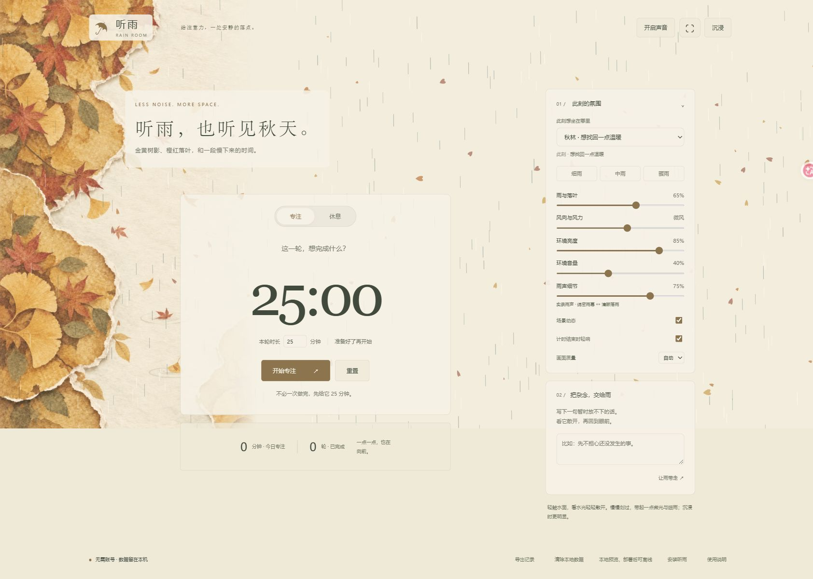

# 听雨 · Rain Room

想安静待一会儿的话，这里有雨。

选一处喜欢的风景，听听雨，看看落叶。等想开始了，再写下眼前的一件小事，给它一点时间。

也可以只来发会儿呆。这里的计时器，准备好了再按就好。

**[打开听雨，坐一会儿 ↗](https://leavesautumn377-byte.github.io/rain-room/)**

免费使用，无需注册。手机和电脑都可以直接打开，安装是可选的。



## 第一次来，可以这样用

1. **选一处风景。** 在「此刻想坐在哪里」里，挑一个今天喜欢的地方。手机上先点底部的「雨景」。
2. **点「开启声音」。** 雨声需要手动开启；音量、亮度和天气都可以按自己的喜好调节。手机上点底部的「调节」就能找到这些设置。
3. **想专注时，再开始计时。** 写下这一轮想做的事，选好分钟数，点「开始专注」。默认是 25 分钟，也可以改成 1 到 180 分钟。手机上点底部的「专注」。

任务文字可以留空。完成一轮后，你可以自己决定要不要开始休息。

如果只想看风景，点「沉浸」就能把面板收起来。电脑上按 `H` 可以进入或退出沉浸模式。

有句话一直在脑子里打转，也可以写进「把杂念，交给雨」，再点「让雨带走」，看文字慢慢散开。手机上从底部的「放下」进入。这段文字不会保存。

## 今天想坐在哪里

| 地方 | 能看到什么 |
| --- | --- |
| 樱花 | 樱花与细雨，慢慢飘落的花瓣 |
| 荷塘 | 荷叶与落雨，轻触时泛起的涟漪 |
| 秋林 | 金黄与橙红的落叶，伴着雨声 |
| 冻湖 | 覆雪的岸边，飘雪与柔和风声 |
| 晴日 | 树影与缓慢落叶，伴着柔和风声 |
| 窗边 | 蓝调雨夜里的一盏暖灯，玻璃上滑落的雨滴 |

## 喜欢的话，把它放到桌面

直接用网页就已经可以听雨。安装后，下次可以从桌面图标打开独立窗口。

先在浏览器里打开 **[听雨](https://leavesautumn377-byte.github.io/rain-room/)**，再按设备选择下面的步骤。

### 电脑

1. 用 **Chrome 或 Edge** 打开网页，点击页面底部的「安装听雨」。
2. 如果弹窗里出现「安装到设备」，点击它，再按浏览器提示确认。
3. 如果没有这个按钮，查看浏览器地址栏的安装图标，或菜单里的安装选项。浏览器不支持安装时，可以收藏网址，照常使用。

### 安卓手机

1. 用 **Chrome** 打开网页。
2. 点右上角的 **⋮**，选择「安装应用」或「添加到主屏幕」，按提示确认。支持安装的浏览器也可以从页面底部的「安装听雨」进入。

其他安卓或鸿蒙浏览器的菜单名称可能不同。如果能找到「添加到桌面」或「添加到主屏幕」，可以使用；没有的话，先收藏网页即可。目前暂未发布可下载的安卓安装包。

### iPhone 或 iPad

1. 用 **Safari** 打开网页。
2. 点 **分享按钮**，选择「添加到主屏幕」，再点「添加」。

如果是在微信等应用里打开，先选择「在浏览器中打开」，再进行安装。

## 关于离线和记录

第一次请保持联网，等页面底部出现 **「已备好离线雨声」**，之后就可以断网使用已缓存的画面和声音。如果离线资源被浏览器清理，需要再次联网准备。

你的设置、当前任务和专注记录保存在正在使用的浏览器里，不会在设备之间同步。清除浏览器的网站数据也会清除这些记录；想留一份时，可以点「导出记录」，导出的文件不含任务文字。

计时期间请保持页面或应用打开。关闭后无法提醒，放到后台时提示音也可能延迟。今日统计只计入完整完成的专注轮次。

看到「更新听雨」时，点一下就能切换到新版本。

<details>
<summary>如果你也想看看代码</summary>

### 在自己的电脑上运行

先安装 Node.js 20 或更高版本，再在终端里依次运行下面三行。无需运行 `npm install`。

```sh
git clone https://github.com/leavesautumn377-byte/rain-room.git
cd rain-room
npm run dev
```

打开终端显示的本地网址。端口被占用时，改用 `npm run dev -- --port 5174`。

```sh
npm test
npm run check
npm run build
npm run preview
```

`npm run build` 会生成 `dist/`，可部署到静态网站托管服务。

项目使用原生 HTML、CSS、JavaScript，以及 Canvas、Web Audio 和 Service Worker。通过 AI 协作迭代，维护者参与产品需求、画面筛选和体验验收。背景是经过筛选的 AI 生成插画，天气效果由 Canvas 绘制。`android/` 中保留了 Android WebView 封装源码。

[参与开发](CONTRIBUTING.md) · [验证说明](docs/TESTING.md) · [素材来源](docs/ASSETS.md) · [许可证](LICENSE)

</details>
